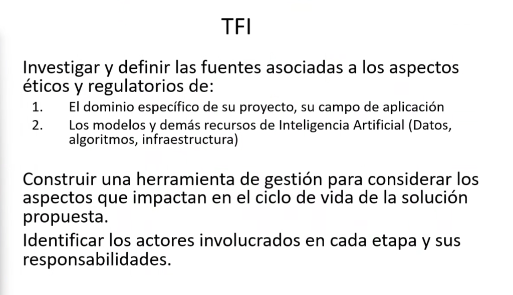

# Antecedente TFI - Aspectos Éticos, Regulatorios y de Gestión del Ciclo de Vida

## Transcripción de la Consigna (TFI)

**Investigar y definir las fuentes asociadas a los aspectos éticos y regulatorios de:**
1. El dominio específico de su proyecto, su campo de aplicación.
2. Los modelos y demás recursos de Inteligencia Artificial (Datos, algoritmos, infraestructura).

**Construir una herramienta de gestión para considerar los aspectos que impactan en el ciclo de vida de la solución propuesta.**

**Identificar los actores involucrados en cada etapa y sus responsabilidades.**
