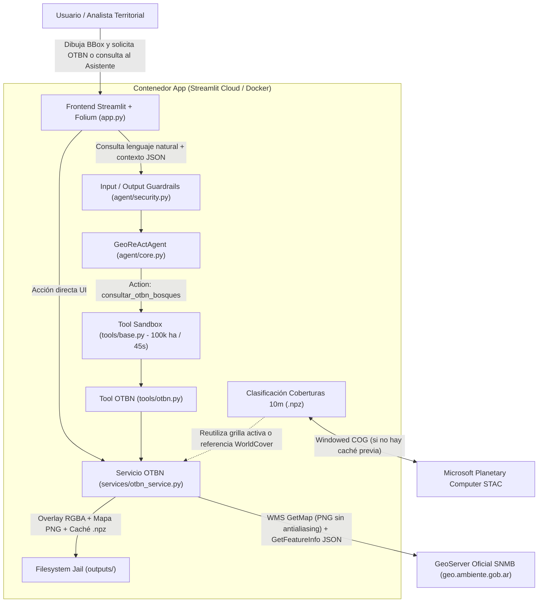

# Arquitectura y Diseño de la Integración OTBN (`feature/otbn`)

> **Alcance documental:** Este documento describe exclusivamente la arquitectura, decisiones técnicas y cambios introducidos en la rama **`feature/otbn`** (derivada de `main`). La documentación preexistente del TFI en la raíz del repositorio (`README.md`, `INFORME_ARQUITECTONICO_TFI.*`, `INFORME_INTEGRAL_TFI_ISBIA.*`, `INSTRUCCIONES_COMPARTIR.md`) se mantiene intacta para preservar la línea base de entrega en `main`.

---

## 1. Análisis de Factibilidad: MapBiomas vs. Geoservicio Oficial SNMB

Al evaluar la integración del **Ordenamiento Territorial de Bosques Nativos (OTBN — Ley Nacional N.° 26.331)** presente en la plataforma de **MapBiomas Argentina**, se verificaron las siguientes características técnicas:

1. **Naturaleza de la capa en MapBiomas (`plataforma.mapbiomas.org/projects/mapbiomas/argentina`):**
   * El OTBN aparece dentro de **Capas auxiliares** (*External Layers*) como un módulo externo de referencia, compilado con categorías I (Rojo), II (Amarillo) y III (Verde).
   * Según los metadatos oficiales de la propia plataforma, **MapBiomas no produce ni actualiza el OTBN**: la capa disponible está **congelada al año 2017** y no incorpora actualizaciones provinciales posteriores.
   * Técnicamente, el visor web consume metadatos internos (`prd.plataforma.mapbiomas.org/api/v1/argentina/...`) y renderiza la capa mediante **tiles ráster XYZ dinámicos generados por Google Earth Engine** (`earthengine.googleapis.com/v1/projects/mapbiomas/maps/<map_id>/tiles/{z}/{x}/{y}`) asociados a identificadores de sesión efímeros.
   * No existe una API pública documentada (REST, GraphQL ni OGC WMS/WFS) para consultar OTBN en MapBiomas (la API GraphQL pública de MapBiomas corresponde únicamente a *MapBiomas Alerta*), ni se publica el *Asset ID* de GEE o descarga directa del OTBN en `argentina.mapbiomas.org/descargas/`.

2. **Alternativa adoptada — GeoServer Oficial SNMB (`geo.ambiente.gob.ar`):**
   * La **Subsecretaría de Ambiente de la Nación / Sistema Nacional de Monitoreo de Bosques (SNMB)** expone de manera pública, gratuita y sin necesidad de API key el servicio estándar OGC (`https://geo.ambiente.gob.ar/geoserver/bosques/wms`), con la capa unificada **`bosques:otbn_nacional`**.
   * Provee tanto representación cartográfica (**WMS `GetMap`**) como atributos jurídicos por consulta puntual (**WMS `GetFeatureInfo`**): provincia (`fna`), categoría (`cam`: `'I' | 'II' | 'III'`), fecha de norma/decreto (`dct`, con consolidaciones observadas hasta `2022-09-22` según jurisdicción) y autoridad provincial de aplicación (`sag`).
   * Es 100 % compatible con el stack ya instalado en [requirements.txt](../requirements.txt) (`urllib`, `Pillow`, `numpy`, `rasterio`, `folium`), evitando incorporar `earthengine-api` o credenciales OAuth2/Service Account de Google Cloud.

---

## 2. Arquitectura Integrada en `feature/otbn`

El módulo OTBN se acopla como una extensión modular respetando las capas existentes de **Ciberseguridad (Guardrails OWASP)**, **Agent Harness** y **Sandbox de Ejecución** (`100.000 ha` y `45 s` de timeout):



---

## 3. Pipeline Técnico de Procesamiento y Cruce Espacial

Implementado en [services/otbn_service.py](../services/otbn_service.py):

1. **Validación de Sandbox Espacial:** Verifica mediante `estimate_bbox_dimensions(bbox, res_m=10.0)` que el recuadro no supere `10.000.000` de píxeles (`~100.000 ha`).
2. **Descarga Discreta sin Antialiasing (`_fetch_wms_otbn_image`):**
   * Consulta `WMS 1.1.1 GetMap` en `SRS=EPSG:4326` con `FORMAT=image/png`, `TRANSPARENT=TRUE` y el parámetro **`format_options=antialias:none`**.
   * *Decisión crítica de diseño:* Se evita `image/png8` porque la cuantización a paleta de 8 bits de GeoServer fusiona el color Amarillo (`Categoría II`) con el Verde (`Categoría III`), mientras que `image/png` de 24/32 bits sin antialiasing preserva exactamente los tres colores definidos en el SLD oficial:
     * **Categoría I (Rojo — Muy alto valor):** `#f10000` (`RGB 241, 0, 0`)
     * **Categoría II (Amarillo — Mediano valor):** `#eff60b` (`RGB 239, 246, 11`)
     * **Categoría III (Verde — Bajo valor):** `#299516` (`RGB 41, 149, 22`)
     * **Sin categoría OTBN:** píxeles transparentes (`alpha = 0`).
3. **Recuperación de Metadatos Jurídicos (`_collect_legal_metadata`):**
   * Selecciona un píxel interior representativo por cada categoría presente en la grilla y ejecuta en paralelo (`ThreadPoolExecutor`, hasta 3 hilos) peticiones `WMS GetFeatureInfo` (`INFO_FORMAT=application/json`) para extraer `fna` (provincia), `dct` (fecha de norma/decreto) y `sag` (autoridad de aplicación).
4. **Cruce Espacial Píxel a Píxel `Cobertura × OTBN` (`_cross_landcover_with_otbn`):**
   * Reutiliza el `.npz` georreferenciado de la clasificación activa (`ESA WorldCover 10m`, `Esri Annual LULC 10m` o `Sentinel-2 NDVI`) si ya existe en sesión; en caso contrario, descarga automáticamente la referencia estructural vía `fetch_landcover_reference_for_bbox()`.
   * Reproyecta la grilla OTBN (`EPSG:4326`) sobre la grilla exacta de cobertura 10 m (`UTM` o `WGS84`) mediante `rasterio.warp.reproject(..., resampling=Resampling.nearest)`.
   * Calcula la matriz `macro_clase × categoría_otbn` (en hectáreas y porcentajes consistentes con la superficie de coberturas) e indicadores clave:
     * Bosque/cobertura leñosa en Categoría I (Rojo), II (Amarillo), III (Verde) y fuera de OTBN.
     * Cultivos agrícolas y suelo desnudo superpuestos con Categorías I (Rojo) y II (Amarillo).
     * Área urbana/construida en Categorías I/II.
5. **Salidas y Visualización:**
   * `overlay_otbn_<tag>.png`: overlay RGBA semi-transparente superpuesto en Folium (`zindex=15`, entre coberturas `10` y drenaje `20`).
   * `mapa_otbn_<tag>.png`: figura analítica de dos paneles (zonificación territorial OTBN + barras horizontales apiladas del cruce `Cobertura × OTBN`).
   * `otbn_grid_<tag>.npz`: caché matricial georreferenciada en `outputs/`.

---

## 4. Inventario de Cambios en la Rama `feature/otbn`

| Archivo | Estado | Rol en la integración |
| :--- | :--- | :--- |
| [services/otbn_service.py](../services/otbn_service.py) | **Nuevo** | Cliente WMS/GetFeatureInfo SNMB, decodificador discreto SLD, cruce `Cobertura × OTBN`, diagnóstico y cartografía. |
| [tools/otbn.py](../tools/otbn.py) | **Nuevo** | Herramienta `analyze_otbn_zoning` para el registro del agente ReAct. |
| [tools/__init__.py](../tools/__init__.py) | **Modificado** | Registra `consultar_otbn_bosques` en `default_registry`. |
| [agent/core.py](../agent/core.py) | **Modificado** | Síntesis cuantitativa OTBN en `_synthesize_real_data()` y ruteo en `_mock_llm_reasoning()` hacia `consultar_otbn_bosques` (manteniendo `rag_documental_inta` para consultas puramente normativas o de IUF/Ley 26.815). |
| [app.py](../app.py) | **Modificado** | Recarga defensiva de módulos, estado `otbn_result`, overlay Folium, botón `🌳 OTBN (Ley 26.331)`, pestaña dinámica con métricas/tabla de cruce, preset en el Asistente e inyección de contexto compacto `[Último Análisis OTBN: ...]`. |
| [docs/ARQUITECTURA_OTBN.md](./ARQUITECTURA_OTBN.md) | **Nuevo** | Documentación arquitectónica específica de esta rama, separada de la documentación de `main`. |

*Archivos sin modificaciones respecto a `main`:* `README.md`, `INFORME_ARQUITECTONICO_TFI.*`, `INFORME_INTEGRAL_TFI_ISBIA.*`, `INSTRUCCIONES_COMPARTIR.md`, `requirements.txt`, `services/drainage_service.py`, `agent/harness.py`, `agent/security.py`, `rag/data/corpus_ejemplo.txt`.

---

## 5. Despliegue Paralelo en Streamlit Community Cloud (sin afectar `main`)

1. Publicar la rama en GitHub:
   ```bash
   git push -u origin feature/otbn
   ```
2. En **Streamlit Community Cloud** (`share.streamlit.io`) → **New app**:
   * **Repository:** `intacalculemus/AG_TFI_diplo`
   * **Branch:** `feature/otbn`
   * **Main file path:** `app.py`
   * **App URL:** asignar un subdominio separado (p. ej. `ag-tfi-otbn.streamlit.app`).
3. En **Settings → Secrets** de la nueva app, copiar las claves LLM configuradas en la app de `main` (`GROQ_API_KEY`, `HF_TOKEN` o `OPENAI_API_KEY`). El servicio OTBN (`geo.ambiente.gob.ar`) no requiere credenciales.

---

## 6. Limitaciones y Alcance Normativo

* **Actualizaciones provinciales recientes:** Aunque `bosques:otbn_nacional` incluye consolidaciones más recientes que la capa 2017 de MapBiomas (por ejemplo Santa Fe, Santa Cruz y Tierra del Fuego hasta 2022), algunas jurisdicciones con reformas recientes (como Chaco o Salta) pueden figurar con su decreto previo (`dct` informado automáticamente en la interfaz).
* **Uso orientativo (*screening*):** Los resultados de cruce espacial `Cobertura × OTBN` son herramientas técnicas de tamizaje preliminar; para dictámenes catastrales o legales vinculantes debe consultarse la cartografía vigente publicada por la Autoridad Local de Aplicación provincial (`sag`).
